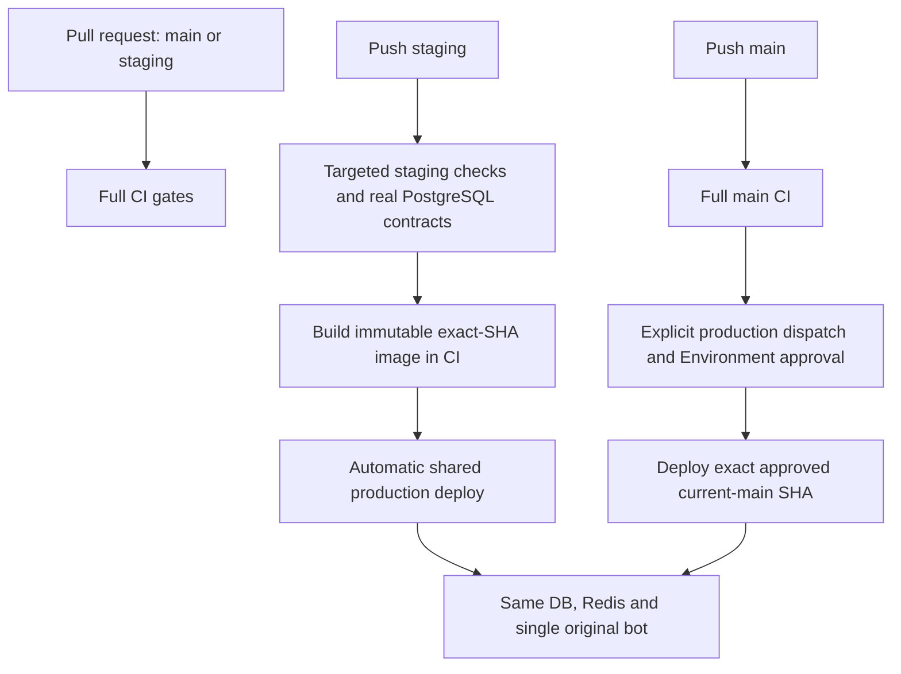

# Deployment (GHCR image + SSH)

Main pushes and pull requests run the full CI gate. Staging pushes run the
targeted `staging-checks.yml` lane. Staging delivery automatically
updates the SAME live Production runtime. The main lane remains an explicit
approved dispatch after successful exact-SHA main CI. Companion documents:
[`PRODUCTION_HARDENING.md`](PRODUCTION_HARDENING.md) (topology and guarantees),
[`RUNBOOK.md`](RUNBOOK.md) (day-2 operations), [`PRODUCTION_RUNBOOK.md`](PRODUCTION_RUNBOOK.md).

## 1. Pipeline overview

The `staging` Environment must own its `DEPLOY_HOST`, `DEPLOY_PORT`,
`DEPLOY_USER`, `DEPLOY_SSH_KEY`, `DEPLOY_KNOWN_HOSTS` secrets and its
`DEPLOY_PATH` / `CONFIGURATION_PATH` variables; GitHub does not inherit these
from `production`. Use a dedicated CI identity, not an operator's personal key.
The identity gate runs before image publication, and deploy still verifies the
current branch SHA and strict pinned host key before any remote mutation.

All application containers use Compose `init: true` to reap orphaned subprocesses.
Do not fix PID exhaustion by disabling health probes or raising the PID ceiling.
The API retains its HTTP probe; worker and bot retain their progress probes.



Production dispatch must supply the complete current-main SHA and explicit
confirmation. A failed, cancelled, incomplete, wrong-workflow or stale CI run
cannot authorize a release. Main pushes alone never deploy production.

Both lanes use `scripts/deploy-production.sh` and Compose project
`cloud-platform-production`: one existing directory, private configuration,
database, Redis, volumes, production bridge and original bot token. Staging
only skips the one-shot provider catalog refresh; scheduled refresh and every
deployment/financial/readiness gate remain active. See [staging lane](../../deploy/staging/README.md).

Staging uses Ruff lint/format, compile/import smoke, secret scan, actionlint,
targeted financial/deployment regressions, fresh migration/physical schema and
real PostgreSQL locking/catalog/wallet contracts. Main keeps the complete
pytest/coverage, mypy, historical migration bridge and other release gates.
Images and Compose candidates come from that same tested commit. SHA tags are
immutable, and OCI revision plus platform-contract labels are checked.
Workflow validation requires Linux ShellCheck plus actionlint, not just a
Windows-only syntax pass. The SSH wrapper's runtime regressions verify token
stdin, a private temporary registry directory and cleanup on every exit.
The main/release coverage floor remains **88%**. Reports use six-digit precision;
release CI and `scripts/verify_ci.py --push-ready` run `scripts/check_coverage.py` against the XML's
integer line counts. A rounded display or successful plugin exit cannot authorize
a result below the exact floor. The gate rejects the observed 39112/44452-line
artifact rather than treating its rounded 88% display as success.

Both lanes share one non-cancelling deployment job group and directory-scoped
`flock`. Website and native releases additionally serialize through
`/var/lock/servercloud-platform-release.lock`, opened by the same deployment OS
user. A release never interrupts an active migration for a newer push.


## 2. Server layout and ownership

```text
RELEASE-OWNED (promoted automatically on every successful deploy):
    Docker image (ghcr.io/<org>/<repo>:<full-sha>)
    /opt/cloud-server-seller/docker-compose.yml   (canonical release contract)

RELEASE/TOPOLOGY INVARIANT (non-secret, enforced from release-owned compose):
    production Telegram transient-state backend = redis
    (TELEGRAM_SESSIONS_BACKEND=redis in the shared compose block; wins over
    a stale server TOML by documented precedence — no manual TOML edit needed)

SERVER-OWNED (never delivered from Git, never overwritten by a deploy):
    /opt/cloud-server-seller/deploy.env           (infrastructure values only, mode 600)
    /etc/cloud-server-seller/configuration.toml   (bot token, callback key,
      provider/payment credentials, database URL, encryption keys, mode 640 or 600)
    persistent Docker volumes/data, host credentials
```

Every deploy ships the exact `deploy/production/docker-compose.yml` from the
exact tested commit as a per-SHA candidate
(`.docker-compose.<FULL_SHA>.candidate.yml`), verifies its SHA-256, runs the
whole release against it, and atomically promotes it to the canonical path
only after all health/stability/revision/financial gates pass. Promotion is the
last fallible step. A failure leaves the previous canonical compose untouched;
it is used for automatic image rollback only when the database remains
compatible under §6. Manual dispatch cannot select an older main SHA or undo
a financial/schema transition.

* `deploy.env` holds infrastructure values: immutable `PLATFORM_IMAGE`,
  `POSTGRES_PASSWORD`, API bind/port, optional management SSH directory and
  configuration path. Releases update only their image selection, not passwords.
* `configuration.toml` is mounted read-only. Deploys validate its environment,
  IRT wallet/display and FX policy, identity mode and signing key without printing
  values. They never overwrite the server-owned file. Staging URLs must address
  that stack's `postgres` and `redis`, not production or an external shared DB.
* No production application secret lives in GitHub (repository, workflow, or
  logs). The only credentials GitHub holds are the SSH access below and the
  ephemeral `GITHUB_TOKEN` used for one GHCR pull per deploy.

## 3. One-time server bootstrap (Ubuntu 22.04/24.04)

Run as root (or with sudo). The deploy user never runs the app as root; it
only needs Docker access.

```bash
# 1. user + Docker Engine + Compose plugin
adduser --disabled-password --gecos '' deploy
usermod -aG docker deploy
apt-get update && apt-get install -y ca-certificates curl gnupg python3 openssh-server
install -m 0755 -d /etc/apt/keyrings
curl -fsSL https://download.docker.com/linux/ubuntu/gpg \
  | gpg --dearmor -o /etc/apt/keyrings/docker.gpg
echo "deb [signed-by=/etc/apt/keyrings/docker.gpg] https://download.docker.com/linux/ubuntu \
  $(. /etc/os-release && echo $VERSION_CODENAME) stable" \
  > /etc/apt/sources.list.d/docker.list
apt-get update && apt-get install -y docker-ce docker-ce-cli containerd.io \
  docker-buildx-plugin docker-compose-plugin
systemctl enable --now docker

# 2. directories (deploy owns its dir; the TOML is root-owned, deploy-readable)
install -d -m 0750 -o deploy -g docker /opt/cloud-server-seller
install -d -m 0750 -o root -g docker /etc/cloud-server-seller

# 3. application configuration (the ONE canonical template lives at the
#    repository root; copy it OUT of a checkout, then edit it)
install -m 0640 -o root -g docker \
  configuration.example.toml \
  /etc/cloud-server-seller/configuration.toml
"$EDITOR" /etc/cloud-server-seller/configuration.toml   # fill in every secret
```

**Configuration contract (one template, one real file).**

| File | Owner | Purpose |
| --- | --- | --- |
| `configuration.example.toml` (repository root) | repository | the SINGLE canonical template: every supported key, safe fake values, production form documented in a comment next to each environment-dependent key |
| `configuration.toml` | operator, local only | the real values; git-ignored, never committed, never printed |
| `/etc/cloud-server-seller/configuration.toml` | operator, server | the real values the containers mount read-only |

The template is the contract, and a check enforces it: a new operator-facing
setting must be added to `configuration.example.toml` in the same change that
introduces it (see `tests/unit/test_config_toml.py`). There is deliberately no
second, production-flavoured example — the deleted `deploy/production/` copy
had drifted and silently lost/duplicated keys.

To upgrade an existing server: diff the template against your local real
`configuration.toml`, merge the missing keys, validate, then install it. A
deployment only ever mounts that file; it never writes or overwrites it.

Validate before installing — the read-only drift check prints KEY PATHS only,
never a value:

```bash
python -m cloud_platform.cli config doctor
```

Exit 0 = every supported key accounted for, no unknown keys, no unreplaced
`CHANGE_ME` placeholder in a production file; exit 1 = the file is unreadable or
invalid, a required key is missing, or a production placeholder survives.

```bash
# 4. deployment env only (the release compose arrives automatically;
#    do NOT copy configuration.toml here and do NOT copy docker-compose.yml —
#    the first successful deploy promotes its own canonical compose file)
cp deploy/production/.env.example /opt/cloud-server-seller/deploy.env
chmod 600 /opt/cloud-server-seller/deploy.env
"$EDITOR" /opt/cloud-server-seller/deploy.env
#   PLATFORM_IMAGE=<first image, filled by the first automated deploy;
#     for the very first deploy any valid ghcr.io SHAtag works, the workflow
#     overwrites it immediately>
#   POSTGRES_PASSWORD=<strong random, must match [database] url in the TOML>
#     generate: openssl rand -base64 32
#   API_PORT=8000

# 5. SSH access for GitHub Actions (append the operator-generated key)
install -d -m 0700 -o deploy -g deploy /home/deploy/.ssh
cat prod_deploy_key.pub >> /home/deploy/.ssh/authorized_keys
chmod 600 /home/deploy/.ssh/authorized_keys

# 6. firewall: SSH in, API port as desired, nothing else published
ufw allow OpenSSH
ufw allow 8000/tcp   # only if the API should be reachable directly
ufw --force enable

# 7. GHCR access needs no stored credential: every deploy logs in with the
#    short-lived GITHUB_TOKEN over the SSH session (never printed or saved).
```

First production deployment: after successful current-main push CI, dispatch
`deploy-production` with that full SHA and explicit confirmation, then obtain
the protected production Environment approval. Staging pushes deploy only to
their separately bootstrapped staging Environment.

## 4. GitHub configuration the operator must set manually

Repository settings:

* Enable **Dependency graph** and **Dependabot alerts** under Advanced Security.
  Repository administrators can enable both with
  `PUT /repos/{owner}/{repo}/vulnerability-alerts`. A disabled graph makes the
  dependency-review API return HTTP 403; fix the repository setting rather
  than skipping or weakening the dependency review check.
* Protect `main`: require a pull request, resolved conversations and up-to-date
  required CI checks, including administrators; disallow force pushes/deletion.
  Separately protect the production Environment with a required reviewer and
  a `main`-only deployment branch policy. A merge is not deployment approval.

Environment **`production`** (repository → Settings → Environments):

| Type | Name | Value |
| --- | --- | --- |
| Secret | `PROD_SSH_KEY` | private OpenSSH key matching the server's `authorized_keys` |
| Secret | `PROD_KNOWN_HOSTS` | operator-verified `known_hosts` entries; authenticate fingerprints out-of-band before accepting `ssh-keyscan` output, and never disable host verification |
| Variable | `PROD_HOST` | production hostname or IP |
| Variable | `PROD_PORT` | SSH port (default `22` when unset) |
| Variable | `PROD_USER` | `deploy` |
| Variable | `PROD_DEPLOY_PATH` | `/opt/cloud-server-seller` |

The **`staging`** GitHub release Environment contains secrets `DEPLOY_HOST`,
`DEPLOY_PORT`, `DEPLOY_USER`, `DEPLOY_SSH_KEY`, `DEPLOY_KNOWN_HOSTS`, and variables
`DEPLOY_PATH`, `CONFIGURATION_PATH`, all selecting the SAME existing Production
runtime/private TOML. Restrict its branch to `staging`; it is an automatic release
lane, not runtime isolation. The operator elected to supply these secrets.
Never upload the operator's existing private SSH key or hide missing credentials.

Package visibility: the GHCR image may stay private. Each workflow supplies the
short-lived `GITHUB_TOKEN` on stdin within one SSH session. That session creates
a private temporary `DOCKER_CONFIG`, uses it for the pull/deploy, and removes it
on exit; the new login is not written to the server user's default Docker
credential file. Earlier pipelines may have left credentials there: inspect
their presence without printing values and rotate/remove them only with
operator authorization. Application secrets remain server-owned.

## 5. Deployment sequence (what the script does)

1. Acquire the target-directory lock; validate tools, bounded health settings,
   server-owned files, directory/project ownership and candidate Compose SHA-256.
   Reject symlinks, invalid profiles and non-SHA references before service mutation.
2. Pull the exact image; require its OCI revision and platform-contract labels.
   Validate the mounted server configuration without printing its values.
3. Record the previous image, change only `PLATFORM_IMAGE` in `deploy.env`,
   and establish PostgreSQL/Redis health. Read the database and image heads;
   a database with multiple revisions is not deployable.
4. Stop API, worker and the single bot. Create an encrypted backup with the
   canonical backup job, then run `alembic upgrade head`. A backup failure
   prevents migration. Alembic also holds a PostgreSQL migration lock.
5. Require the database head to equal the image head and verify the physical
   schema, including the uniqueness/partial-index contracts used by upserts.
   A version stamp alone is not schema evidence.
6. Refresh provider facts (release profile only), then normalize catalog
   selling currency. These bounded idempotent operations report failures;
   the later read-only storefront gate remains authoritative during outages.
7. Start API, worker and one bot. Require API readiness, PostgreSQL/Redis
   health, ARQ worker health, a fresh existing-poller bot heartbeat, and stable
   worker/bot container identities and restart counts.
8. Recheck the migration head and read-only storefront readiness. Run
   `scripts/post_deploy_smoke.py`: database/worker checks and wallet/payment
   reconciliation share a read-only repeatable-read transaction. Smoke tests
   do not create invoices, credit wallets or provision provider resources.
9. Print service status, recheck candidate integrity and atomically promote
   the compose file. Images and persistent volumes are not automatically
   pruned; keep the previous image available for compatible recovery.

## 6. Migration and rollback behavior

### Ambiguous historical revision `0050`

The released histories used `0050` for different changes. The canonical chain
retains staging's `0050` through `0053`; additive bridge `0054` inspects the
physical schema and preserves the main identity/payment/prepay changes too.
Do not rename deployed revision stamps or use `alembic stamp` as a repair.
Fresh databases, `0049`, both physical variants of `0050`, and staging `0053`
are exercised by `tests/live/test_migration_bridge.py`, including rows,
indexes, constraints and physical parity at one head.

The bridge projects compatible payment evidence between legacy columns and
JSON details. Conflicting evidence or duplicated gateway/idempotency facts
abort the transaction rather than guessing, deduplicating or deleting money
history. Resolve such conflicts with an approved, audited data decision, then
retry the forward migration.

### Recovery rules

* Deploy creates a fresh encrypted backup after draining writers and before
  migration. Also require a recent off-host copy and successful clean-target
  restore drill before approving a schema/financial-epoch advance.
* `alembic downgrade` is never part of recovery. Physical parity does not prove
  that an old image understands a new currency or financial epoch.
* After a migration is attempted, if either the target image head or observed
  database head differs from the pre-deploy revision, candidate writers are
  stopped and **old-image restart is refused**, even when the migration fails
  before stamping. Recover with a reviewed forward fix or a separately
  verified operator recovery procedure.
* Without a schema transition, an old image may restart only after physical
  parity and (after candidate activation) matching platform-contract checks.
  Failure recovery still leaves the workflow red.
* A first deployment has no rollback image; failed candidate writers are
  stopped. Never report an unavailable rollback target as success.
* Do not manually run `compose up` on an old image after a forward migration.
  Schema/data restoration is a separate destructive operation requiring
  explicit approval, an isolated restore verification and writer exclusion.

## 7. Logs, inspection, backup

```bash
cd /opt/cloud-server-seller
docker compose --env-file deploy.env -f docker-compose.yml ps
docker compose --env-file deploy.env -f docker-compose.yml logs --tail=200 api worker bot
docker compose --env-file deploy.env -f docker-compose.yml exec -T api alembic current
curl -fsS http://127.0.0.1:8000/health/ready
# additional manual encrypted backup (deployment also creates one):
docker compose --env-file deploy.env -f docker-compose.yml --profile backup run --rm backup
```

Deployments never delete volumes (`docker compose down -v` is forbidden in
automation). Extra scheduled/manual backups use the same encrypted backup job.

## 8. Secrets discipline (quick reference)

GitHub Actions logs show: commit SHA, image tag, target path, migration
result, service status, health result, rollback status. They MUST never show:
the SSH private key, `POSTGRES_PASSWORD`, `configuration.toml` content, the
Leaseweb key, the Telegram token, the callback signing key, or payment
secrets. Configuration validation suppresses input values. The workflow sends
the GHCR token on stdin, unsets it and removes its private temporary Docker
credential directory on exit. Never bypass SSH host-key verification to deploy.

## 9. CPU-starved startup and health policy

The image and production Compose use the same isolated `python -I -S` HTTP
liveness probe (no application/configuration imports): interval/start-interval
45s, timeout 15s, startup grace 120s, four retries. Worker and bot probes run
every 60s, including startup, with timeout 20s, startup grace 120s and three
retries. Explicit start intervals prevent Docker's faster startup probing from
adding load precisely when a cold process is CPU-starved.
The explicit start interval requires Docker Engine 25+; verify Engine and
Compose support before approving rollout (see the Docker HEALTHCHECK reference).

Both process-local heartbeat windows are bounded at 180s. Worker evidence is
refreshed only when ARQ's real Redis sentinel changes (the ARQ cadence remains
30s); polling evidence only follows a successful response from the EXISTING
Telegram poller. Probes never send `getUpdates`, refresh heartbeat files, read
secrets or declare a merely existing process healthy. Persistent event-loop,
Redis or Telegram failures still fail closed after this bounded grace.

`/health/ready` executes the existing PostgreSQL/session-store probes against
the cached application container (Redis is mandatory in production). A failed
dependency or the 3s probe deadline returns HTTP 503, without exception details
or credentials. `/health/live` remains independent of those dependencies.

CD allows 96 readiness/health attempts with 5s retry intervals (a nominal
480s retry budget, plus probe execution time) and 45 minutes overall; backup,
migration-head/physical-schema, single-poller, storefront, financial and
stabilization gates remain mandatory. Both lanes share the GitHub deployment
group, a per-target host lock and the website/platform host lock. Alembic also
holds the existing PostgreSQL transaction advisory lock during online migration.
CI candidates include run ID/attempt to avoid overwriting active artifacts;
canonical Compose is promoted only after all checks pass.

This preparation commit does not authorize a push, deployment or restart.
High hypervisor CPU steal is an infrastructure problem: these bounded tolerances
do not repair unavailable CPU capacity.


## 10. Approval-gated staged production rollout

1. **Select the tested release, not a branch name.** Record the full commit SHA,
   immutable image digest, candidate Compose checksum, previous image/digest,
   canonical Compose checksum and pre-deploy database head. Push to `staging`
   automatically deploys the existing production runtime after CI; ordinary
   `main` pushes do not. Manual `main` release additionally requires explicit
   confirmation and the protected production Environment. Do not push this
   preparation commit without a new approval.
2. **Preflight before draining.** Verify Engine 25+ / compatible Compose,
   available CPU/PIDs/memory/disk, SSH host key, private configuration, image
   provenance, unchanged contract and off-host encrypted backup/restore evidence.
   Retain the previous image and Compose; never print expanded secret values.
3. **Serialize and drain.** Use the existing pipeline, target-directory flock,
   shared website/platform flock and PostgreSQL transaction advisory lock.
   Stop the previous API/worker/bot writers and confirm the old Telegram poller
   exited; do not start a second poller for testing or rollback.
4. **Back up and migrate once.** Require the canonical encrypted backup job to
   succeed after writers drain. Run the one-shot migrate container once for
   this release, then require the expected single Alembic head and physical
   schema parity. Failure stops activation. Do not separately launch another
   `alembic upgrade` from an operator shell or service startup.
5. **Activate the tested application set.** The pipeline starts API, worker
   and exactly one bot with `up -d --no-deps` after the successful migration
   gate; resolving dependencies again would rerun the migrate service. Require
   real API liveness/readiness (including PostgreSQL/Redis), observed ARQ
   progress and successful responses from the existing Telegram poller. No
   probe sends `getUpdates` or refreshes its own evidence. Docker startup grace
   is 120s; each CD health wait uses the bounded attempt budget described above.
6. **Prove stability before promotion.** Check healthy service-specific probes,
   container identities, restart counts, process/PID budget, worker queue smoke,
   storefront and read-only wallet/payment reconciliation. Inventory other
   containers/host services capable of using the same bot token privately;
   a single Compose replica alone does not exclude an external poller. Require
   exactly one authorized poller and no Telegram conflict errors. Only then
   atomically promote the candidate Compose and record the deployed SHA/digest.
7. **Failure is not a successful release.** Stop candidate writers. With no
   schema/financial-epoch transition, allow the existing rollback only after
   physical-schema and contract compatibility checks, using the previous
   canonical Compose/image without overlapping pollers. Re-run readiness,
   worker/bot health and read-only smoke; keep the workflow failed.
8. **Never blindly downgrade the database.** After a schema transition, unknown
   partial migration, or incompatible financial epoch, do not restart old
   writers and do not run `alembic downgrade`. Keep writers drained and review
   a forward fix or separately authorized isolated-restore recovery.
